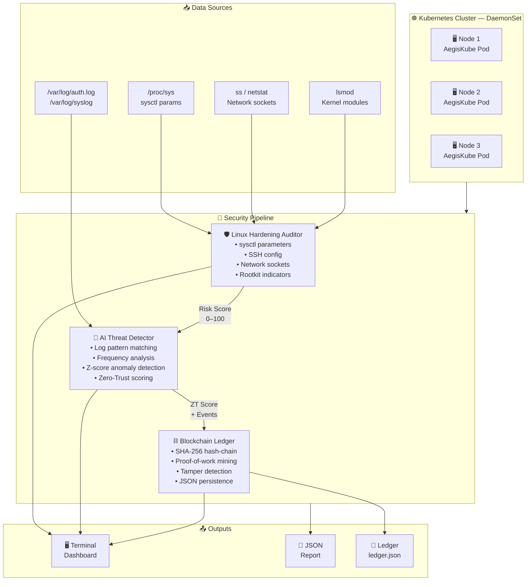

<div align="center">

# ⚔️ AegisKube-SecOps

### High-Performance Linux & Kubernetes Cybersecurity Sentinel

*AI-Driven Anomaly Detection · Blockchain Audit Ledger · Zero-Trust Scoring*

---

[](https://www.python.org/)
[](https://www.kernel.org/)
[](https://kubernetes.io/)
[](https://github.com/nawaz-sharif/aegiskube-secops)
[](https://github.com/nawaz-sharif/aegiskube-secops)
[](https://github.com/nawaz-sharif/aegiskube-secops)
[](LICENSE)
[](https://github.com/nawaz-sharif/aegiskube-secops/actions)
[](https://github.com/nawaz-sharif/aegiskube-secops/pkgs/container/aegiskube-secops)

</div>

---

## 🌐 Overview

**AegisKube-SecOps** is an enterprise-grade, open-source cybersecurity sentinel written in pure Python and Bash. It continuously monitors Linux hosts and Kubernetes clusters for threats using a three-layer defense architecture:

| Layer | Technology | Purpose |
|-------|-----------|---------|
| 🛡️ **Audit** | Linux Hardening Auditor | sysctl, SSH, sockets, rootkit indicators |
| 🤖 **Detect** | AI/ML Threat Detector | Zero-Trust heuristic & statistical scoring |
| ⛓️ **Attest** | Blockchain Audit Ledger | Immutable SHA-256 hash-chain alert log |

> **Zero external dependencies** — runs on any Linux system or Kubernetes node with Python 3.10+.

---

## 🏗️ System Architecture



---

## ✨ Key Features

### 🛡️ Linux Hardening Auditor
- **15+ sysctl security parameters** — kernel ASLR, ptrace scope, IP forwarding, SYN-cookies, ICMP redirects
- **SSH daemon hardening** — PermitRootLogin, PasswordAuthentication, X11Forwarding, MaxAuthTries
- **Active network socket enumeration** — flags risky listeners (telnet, RDS, TFTP, bindshells)
- **Rootkit indicator scanning** — checks for 11 known rootkit signatures in kernel modules and `/dev`
- **Structured JSON telemetry** — machine-readable output for SIEM ingestion

### 🤖 AI Threat Detection Engine
- **8 regex threat signatures** — brute force, privilege escalation, lateral movement, exploits, port scans
- **Sliding 5-minute frequency window** — logarithmic amplification of repeat attacks
- **Z-score network anomaly detection** — statistical deviation across 5 traffic metrics
- **IP Reputation Tracker** — tracks attacker IPs across sessions with diversity-weighted scoring
- **Zero-Trust composite scoring** — 70% event score + 30% network anomaly, 0–100 scale
- **Actionable recommendations** — context-aware incident response guidance

### ⛓️ Blockchain Audit Ledger
- **SHA-256 hash-chain** — every alert cryptographically linked to its predecessor
- **Proof-of-work mining** — configurable difficulty; makes retroactive tampering computationally prohibitive
- **Tamper detection** — `verify_integrity()` detects any modification to any historical block
- **JSON persistence** — ledger survives restarts; `load()` validates chain on startup
- **Multi-node support** — node_id tracking for distributed Kubernetes deployments

### ☸️ Kubernetes-Native
- **DaemonSet deployment** — runs on every node automatically, including masters
- **Host PID namespace** — full process visibility for rootkit detection
- **RBAC least-privilege** — read-only cluster access via service account
- **Multi-stage Docker build** — minimal production image, security-hardened
- **Health checks** — liveness and readiness probes

---

## 🚀 Quickstart

### Prerequisites

```bash
# Python 3.10 or higher
python3 --version

# Clone the repository
git clone https://github.com/nawaz-sharif/aegiskube-secops.git
cd aegiskube-secops
```

### 🎮 Demo Mode (runs on any OS — no root required)

```bash
python3 src/main.py --demo
```

### 🔍 Linux Hardening Audit (Linux only)

```bash
sudo python3 src/main.py --audit
```

### 🤖 AI Threat Detection on Live Logs

```bash
sudo python3 src/main.py --detect --log /var/log/auth.log
```

### 🚀 Full Pipeline (Live System)

```bash
sudo python3 src/main.py --full \
  --ledger /var/lib/aegiskube/ledger.json \
  --save-json /var/lib/aegiskube/report.json
```

### ⛓️ Verify Ledger Integrity

```bash
python3 src/main.py --verify-ledger /var/lib/aegiskube/ledger.json
```

### 🔐 Kernel Hardening (Linux — requires root)

```bash
# Dry run first
sudo bash scripts/kernel_hardening.sh --dry-run

# Apply hardening + firewall rules
sudo bash scripts/kernel_hardening.sh --firewall

# Rollback if needed
sudo bash scripts/kernel_hardening.sh --rollback
```

---

## ☸️ Kubernetes Deployment

```bash
# Create namespace and deploy DaemonSet
kubectl apply -f k8s/daemonset.yaml

# Watch pods roll out across all nodes
kubectl get pods -n security-monitoring -w

# View live security reports from a node
kubectl logs -n security-monitoring -l app=aegiskube-secops -f

# Check blockchain ledger from a pod
kubectl exec -n security-monitoring \
  $(kubectl get pod -n security-monitoring -l app=aegiskube-secops -o jsonpath='{.items[0].metadata.name}') \
  -- python3 src/main.py --verify-ledger /data/aegiskube_ledger.json
```

---

## 🐳 Docker

```bash
# Build image
docker build -t aegiskube-secops:latest .

# Run demo
docker run --rm aegiskube-secops:latest --demo

# Run on live Linux host
docker run --rm \
  --privileged \
  --pid=host \
  -v /etc:/host/etc:ro \
  -v /var/log:/host/var/log:ro \
  -v /data:/data \
  aegiskube-secops:latest --full \
    --ledger /data/ledger.json \
    --save-json /data/report.json
```

---

## 📁 Project Structure

```
aegiskube-secops/
├── src/
│   ├── main.py                   # CLI entrypoint & terminal dashboard
│   ├── linux_hardening_audit.py  # Kernel/SSH/socket/rootkit auditor
│   ├── ai_threat_detector.py     # AI/ML heuristic anomaly detector
│   └── blockchain_audit_ledger.py# SHA-256 hash-chain audit ledger
├── scripts/
│   └── kernel_hardening.sh       # Linux sysctl & iptables hardener
├── k8s/
│   └── daemonset.yaml            # Kubernetes DaemonSet + RBAC
├── tests/
│   └── (inline in CI pipeline)
├── .github/
│   └── workflows/
│       └── secops-ci.yml         # GitHub Actions CI/CD pipeline
├── Dockerfile                    # Multi-stage production image
├── requirements.txt              # Zero runtime deps (stdlib only)
└── README.md
```

---

## 🔒 Security Design Principles

| Principle | Implementation |
|-----------|---------------|
| **Zero Trust** | Every subsystem scores independently; composite weighted score |
| **Defense in Depth** | Audit → Detect → Attest pipeline |
| **Immutability** | Blockchain hash-chain prevents log tampering |
| **Least Privilege** | Kubernetes RBAC; capability-based Docker security context |
| **Zero Dependencies** | Pure Python stdlib — no supply-chain risk |
| **Auditability** | Every alert committed to tamper-evident ledger with PoW |

---

## 📊 Threat Scoring Reference

```
Zero-Trust Score    Threat Level    Action
──────────────────────────────────────────────
85 – 100            ☣  CRITICAL     Immediate incident response
65 – 84             🔴 HIGH         Investigate — likely attack
40 – 64             🟠 MEDIUM       Suspicious — investigate
20 – 39             🟡 LOW          Monitor — weak signal
 0 – 19             ✅ NOMINAL      Normal — continue monitoring
```

---

## 🧪 Running Tests

```bash
# All tests run inline via CI pipeline
python3 -m pytest tests/ -v --cov=src

# Or run the CI smoke test locally:
python3 src/main.py --demo --save-json /tmp/report.json && \
  python3 -c "
import json
data = json.load(open('/tmp/report.json'))
assert data['ledger']['chain_valid'], 'Chain integrity failed!'
print('All checks passed ✅')
"
```

---

## 📋 CI/CD Pipeline

The [GitHub Actions workflow](.github/workflows/secops-ci.yml) includes:

| Job | Description |
|-----|-------------|
| 🔍 Lint | flake8, black, isort, mypy, bandit |
| 🚀 Smoke Test | `python3 src/main.py --demo` on Python 3.10/3.11/3.12 |
| 🧪 Unit Tests | Blockchain tamper detection, AI pattern matching, audit audit |
| 🐳 Docker Build | Multi-stage build + container smoke test |
| 🔐 Dep Scan | pip-audit + safety CVE check |
| 📋 SBOM | SPDX Software Bill of Materials |

---

## 🗺️ Roadmap

- [ ] Prometheus metrics exporter (port 9090)
- [ ] Grafana dashboard template
- [ ] eBPF-based real-time syscall tracing
- [ ] MITRE ATT&CK framework mapping
- [ ] Distributed blockchain gossip across cluster nodes
- [ ] Slack/PagerDuty alert integrations
- [ ] WASM-compiled signatures for edge deployments
- [ ] CIS Kubernetes Benchmark compliance checker

---

## 🤝 Contributing

Contributions, issues, and feature requests are welcome!

1. Fork the repository
2. Create your feature branch: `git checkout -b feature/amazing-feature`
3. Commit your changes: `git commit -m 'feat: add amazing feature'`
4. Push to the branch: `git push origin feature/amazing-feature`
5. Open a Pull Request

Please ensure:
- All CI jobs pass
- New features include tests
- Code is formatted with `black` and passes `flake8`

---

## 📄 License

This project is licensed under the **Apache License 2.0** — see the [LICENSE](LICENSE) file for details.

---

## 👤 Author

<div align="center">

**Nawaz Sharif**

*Senior Linux Developer | Kubernetes | Cybersecurity & Blockchain Architect | AI/ML & Python | DevOps & Cloud*

📍 Dubai, United Arab Emirates

[](mailto:contact@nawazsharif.in)
[](https://github.com/nawaz-sharif)

---

*"Security is not a product, but a process."* — Bruce Schneier

</div>
