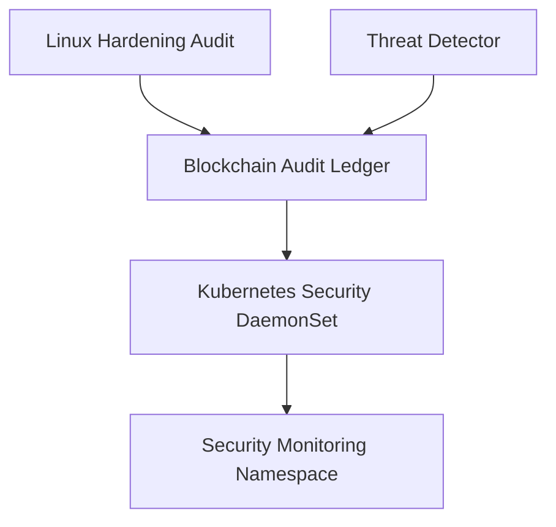

# AegisKube SecOps

AegisKube SecOps is a security monitoring, Linux hardening audit, and threat detection framework featuring blockchain-based audit logging.

## Architecture



## Clone Repository

```bash
git clone [https://github.com/hey-nawazsharif/aegiskube-secops.git](https://github.com/hey-nawazsharif/aegiskube-secops.git)
cd aegiskube-secops
```

## Quick Start

To set up the environment and run the core verification script:
```bash
python3 -m venv venv
source venv/bin/activate
pip install -r requirements.txt
python3 src/test_sentinel.py
```
